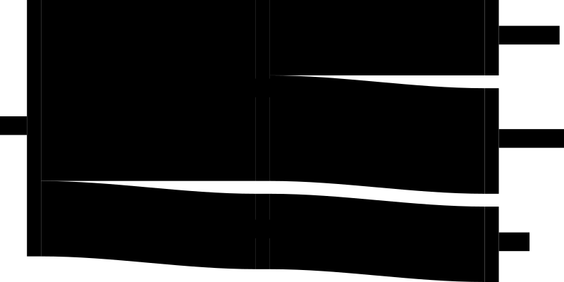
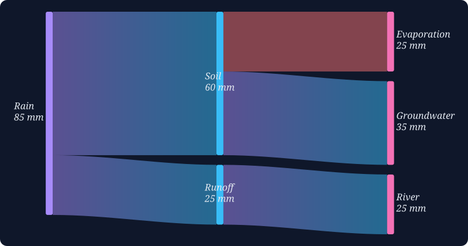
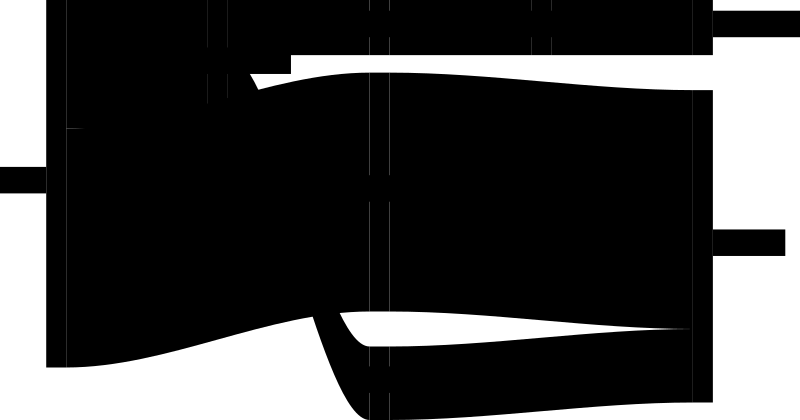

# SankeyRiver

A small, dependency-free JavaScript library for Sankey diagrams, made for scientific reporting: water balances, mass and energy budgets, and scenario comparisons.

- **Pure SVG, styled with plain CSS.** Every node, flow and label is a normal SVG element with a predictable `id` and `class`. Restyle it from your own stylesheet; the built-in defaults have zero specificity, so your CSS always wins. The result is a real vector image you can export or print.
- **Full control over layout.** The layout is automatic, but you can override it per node: force a column, set the order inside a column, add extra spacing, or place a node relative to another node.
- **Values first.** Node heights and flow widths are exact and proportional to the data, and a node's size is the larger of its inflow and outflow. Labels and tooltips can be functions, so you can show units and rounding.
- **Tiny and dependency-free.** About 10 kB minified, one ES module, no D3. Import it straight from a URL.
- **Interactive.** It has HTML tooltips, you can drag nodes to fine-tune the layout, and several charts can share one page.



[Live examples](https://muldernielsdeltares.github.io/SankeyRiver/examples/)

## Installation

SankeyRiver is an ES module. Import it from GitHub Pages:

```js
import { Sankey } from "https://muldernielsdeltares.github.io/SankeyRiver/sankey.min.js"
```

That URL always serves the latest build of `main`. To pin a version, use jsDelivr with a branch, tag or commit:

```js
import { Sankey } from "https://cdn.jsdelivr.net/gh/muldernielsdeltares/SankeyRiver@main/dist/sankey.min.js"
```

## Minimal example

[Open live](https://muldernielsdeltares.github.io/SankeyRiver/examples/minimal.html) · [source](examples/minimal.html)

```html
<div id="chart" style="width: 800px; height: 400px"></div>

<script type="module">
    import { Sankey } from "https://muldernielsdeltares.github.io/SankeyRiver/sankey.min.js"

    new Sankey("chart", {
        flows: [
            { from: "Rain", to: "Soil", value: 60 },
            { from: "Rain", to: "Runoff", value: 25 },
            { from: "Soil", to: "Evaporation", value: 25 },
            { from: "Soil", to: "Groundwater", value: 35 },
            { from: "Runoff", to: "River", value: 25 },
        ],
    })
</script>
```

You only pass flows. Nodes are created from the `from` and `to` names, and columns and positions are worked out automatically. The chart fills the container element, so give the container a width and a height (500 × 500 px is used if it has none).

To redraw, for example after the data changes, call `new Sankey(...)` again on the same container. It replaces the old chart.

## Styling with CSS

Everything in the chart is SVG, so you can style it from your own stylesheet ([open live](https://muldernielsdeltares.github.io/SankeyRiver/examples/styling.html) · [source](examples/styling.html)):



```html
<style>
    #chart { width: 800px; height: 420px; background: #0f172a; border-radius: 12px; }
    #chart svg { font-family: Georgia, serif; }

    #chart rect[id^="node-"] { fill: #38bdf8; rx: 3px; }
    #chart rect.node-column-0 { fill: #a78bfa; }
    #chart rect.node-column-last { fill: #f472b6; }

    #chart path[id^="flow-"] { fill: url(#flow-gradient); opacity: 0.5; transition: opacity 0.2s; }
    #chart path[id^="flow-"]:hover { opacity: 0.95; }
    #chart path.loss { fill: #f87171; }

    #chart g[id^="label-node"] rect { fill: none; }
    #chart g[id^="label-node"] text { fill: #e2e8f0; font-style: italic; }
</style>

<!-- any SVG paint server on the page can be used, e.g. a gradient -->
<svg width="0" height="0" style="position: absolute">
    <defs>
        <linearGradient id="flow-gradient">
            <stop offset="0%" stop-color="#a78bfa" />
            <stop offset="100%" stop-color="#38bdf8" />
        </linearGradient>
    </defs>
</svg>

<div id="chart"></div>

<script type="module">
    import { Sankey } from "https://muldernielsdeltares.github.io/SankeyRiver/sankey.min.js"

    new Sankey("chart", {
        flows: [
            { from: "Rain", to: "Soil", value: 60 },
            { from: "Rain", to: "Runoff", value: 25 },
            { from: "Soil", to: "Evaporation", value: 25, className: "loss" },
            { from: "Soil", to: "Groundwater", value: 35 },
            { from: "Runoff", to: "River", value: 25 },
        ],
        flowBaseConfig: {
            tooltip: (flow) => `<b>${flow.from}</b> &rarr; <b>${flow.to}</b><br>${flow.value} mm`,
        },
        nodeBaseConfig: {
            width: 12,
            label: { text: (node) => `${node.id}\n${node.size} mm` },
        },
        margin: [20, 20, 20, 20],
    })
</script>
```

### What you can select

The SVG gets the id `<containerId>_` (here `chart_`) and contains three groups:

| Element | id | classes |
| --- | --- | --- |
| Node | `rect#node-<id>` | `node-column-<n>`, `node-column-middle` or `node-column-last`, plus `className` |
| Flow | `path#flow-<from>-<to>` | `className`; `flowvalue-zero` when the value is 0 |
| Label | `g#label-node-<id>` (a `rect` and a `text`) | `label-column-<n>`, `label-column-middle` or `label-column-last` |

In ids, every character other than a letter, digit or `_` is removed: `North Sea` becomes `node-NorthSea`.

You can also style a single node or flow from the config with `style: { fill: "red" }`. Those styles are scoped to the chart and override your stylesheet.

## Placing nodes

The automatic layout puts each node one column to the right of its rightmost input. Nodes without outputs go to the last column. Inside a column, nodes are stacked from top to bottom in the order they first appear in the flows, with a gap of `padding` px between them.

You can change any of this per node with `nodeConfig` ([open live](https://muldernielsdeltares.github.io/SankeyRiver/examples/placement.html) · [source](examples/placement.html)):



```js
new Sankey("chart", {
    flows: [
        { from: "Rhine", to: "Waal", value: 65 },
        { from: "Rhine", to: "Pannerdensch Kanaal", value: 35 },
        { from: "Pannerdensch Kanaal", to: "Nederrijn", value: 20 },
        { from: "Pannerdensch Kanaal", to: "IJssel", value: 15 },
        { from: "Waal", to: "North Sea", value: 65 },
        { from: "Nederrijn", to: "North Sea", value: 20 },
        { from: "IJssel", to: "IJsselmeer", value: 15 },
        { from: "IJsselmeer", to: "Wadden Sea", value: 15 },
    ],
    nodeConfig: {
        // force a column; by default Waal would sit in column 1
        Waal: { column: 2 },
        // order within a column: lower comes first (default 0)
        IJssel: { sorting: -1 },
        // same height as IJsselmeer
        "Wadden Sea": { relativeTo: { id: "IJsselmeer" } },
        // after Wadden Sea, with one extra gap (= 2 gaps from the top)
        "North Sea": { sorting: 1, paddings: 2 },
        // extra gap above the Nederrijn
        Nederrijn: { paddings: 3 },
    },
})
```

| Option | What it does |
| --- | --- |
| `column` | Puts the node in this column (0 is the first). |
| `sorting` | Order within a column; lower comes first. Default `0`; ties keep the order of the flows. |
| `paddings` | Number of gaps above this node, counted from the top of the column. By default the *n*-th node in a column has *n* − 1 gaps above it. Nodes below it continue counting from this number. |
| `relativeTo` | `{ id, y1, y2 }` places the node at `ref.y + y1 × ref.size + y2 × node.size`, in data units. `{ id }` aligns the tops, `{ id, y1: 1 }` places the node directly below the reference, `{ id, y1: 1, y2: -1 }` aligns the bottoms, and `{ id, y1: 0.5, y2: -0.5 }` centres it on the reference. |
| `label.position` | `"left"`, `"right"` or `"center"`. The default is left in the first column, right in the last column and centred in between. |

Things to know when placing nodes:

- **`relativeTo` is applied before the gaps are added.** The reference node is first placed in data units, and only then are the gaps from `padding` added. If the reference node has gaps above it, the relative node does not get them, so add `paddings` to the relative node to match.
- **Check for overlaps yourself.** A relative node does not push other nodes in its column out of the way, so use `sorting` to keep them apart.
- **The reference node must already have a position.** It needs to be in an earlier column, or come earlier in the same column by `sorting`. Otherwise `relativeTo` is ignored.
- **`column` only moves that node.** The nodes it flows into are placed as if it were still in its automatic column, so check that they still sit to the right of it.
- **Flows can't loop back.** A loop such as A → B → A makes the constructor throw an error.

## Flow shapes: `b` or `th`

Each flow can be drawn in two ways, set with `render` (per flow, or for all flows in `flowBaseConfig`):

| | `b` (default) | `th` |
| --- | --- | --- |
| Shape | Two curves shifted vertically, filled in between | Ribbon of constant perpendicular thickness |
| Value accuracy | The vertical height equals the value along the whole flow | The width across the flow equals the value |
| Steep flows | Look thinner in the middle (pinched) | Keep their thickness |
| Overlap of flows | Only where flows cross anyway, e.g. a flow that skips columns | More often, on steep or thick flows |

Both are exact, measured in a different direction. `b` is the safe choice: it doesn't add overlap and works well in most charts. `th` looks more correct for a few thin flows with relatively large slopes: there `b` visibly pinches, while `th` keeps the width the eye reads as the value.

`th` is named after the offset-curve method of Tiller and Hanson ([Offsets of Two-Dimensional Profiles](https://ieeexplore.ieee.org/abstract/document/4055919), *IEEE Computer Graphics and Applications* 4(9), 1984), but uses a simpler variant: it offsets 30 points along the curve and joins them with straight lines. At chart sizes this looks the same.

## Options

### Chart (second argument of `new Sankey(containerId, config)`)

| Option | Default | Description |
| --- | --- | --- |
| `flows` | (required) | Array of flows, see below. |
| `nodeConfig` | `{}` | Per-node options, keyed by node name. |
| `nodeBaseConfig` | `{ width: 20 }` | Options applied to every node. `nodeConfig` overrides them. |
| `flowBaseConfig` | `{ render: "b" }` | Options applied to every flow. Options on the flow itself override them. |
| `padding` | `20` | Vertical gap between nodes, in px (approximately). |
| `margin` | `[0, 0, 0, 0]` | Space around the chart in px: `[top, right, bottom, left]`. |
| `fontsize` | `12` | Label and tooltip font size in pt. |
| `labelPadding` | `4` | Padding inside the label box, in px. |
| `labelSpaceLeft`, `labelSpaceRight` | `0` | Minimum space reserved for labels at the left and right edges. It grows automatically to fit the labels. |
| `id` | `<containerId>_` | id of the generated `<svg>`. |

### Flow

| Option | Description |
| --- | --- |
| `from`, `to` | Node names (required). |
| `value` | Number, or numeric string (required). A flow with value `0` is drawn as a thin line with class `flowvalue-zero`. |
| `className` | Extra class on the `<path>`. |
| `style` | CSS properties for this flow, e.g. `{ fill: "red" }`. |
| `tooltip` | String (HTML), `(flow) => string`, or `null` for no tooltip. The default is `"<from> → <to>: <value>"`. |
| `render` | `"b"` (default) or `"th"`, see [Flow shapes](#flow-shapes-b-or-th). |

### Node

| Option | Description |
| --- | --- |
| `width` | Node width in px (default `20`). |
| `className` | Extra class on the `<rect>`. |
| `style` | CSS properties for this node. |
| `label.text` | String (use `\n` for line breaks), `(node) => string`, or `null` to hide the label. The default is the node name. |
| `label.position` | `"left"`, `"right"` or `"center"`. |
| `tooltip` | String (HTML), `(node) => string`, or `null`. The default is `"<label> (<size>)"`. |
| `column`, `sorting`, `paddings`, `relativeTo` | See [Placing nodes](#placing-nodes). |

Functions for `label.text` and `tooltip` receive the node, which includes its computed `size` and its `in` and `out` flows.

## Interaction

- **Tooltips:** hover over a node or flow. Tooltips are rendered as HTML, so don't pass untrusted text into them.
- **Dragging:** drag a node to move it, together with its label and flows. This is meant for fine-tuning before you export; the new position isn't saved.

## Exporting for reports

The chart is a plain `<svg>` element, so you can copy it from the page:

```js
const svg = document.querySelector("#chart svg")
const file = new Blob([new XMLSerializer().serializeToString(svg)], { type: "image/svg+xml" })
```

The SVG contains its own `<style>` with the defaults and any `style` options. CSS from your page stylesheet is not included, so for a standalone file either put your styling in `style` options or copy the rules into the SVG.

## Examples

The three charts above run live at https://muldernielsdeltares.github.io/SankeyRiver/examples/, and their source is in [`examples/`](examples). To run them locally (ES modules don't load from `file://`), start a server first:

```bash
python3 -m http.server 8000
```

Then open http://localhost:8000/examples/minimal.html.

## Development

```bash
npm install
npm run dev        # rebuild dist/sankey.js on change
npm run build      # dist/sankey.js
npm run build:min  # dist/sankey.min.js
npm run lint
npm run prettier
```

The source is TypeScript in [`src/`](src), and the bundles in [`dist/`](dist) are committed. Pushing to `main` publishes `dist/` and the examples to GitHub Pages, so every site that imports the Pages URL gets the new build right away.

## Credits

The node layout (column placement, stacking and padding) is adapted from [chartjs-chart-sankey](https://github.com/kurkle/chartjs-chart-sankey) by Jukka Kurkela (MIT). `relativeTo`, the SVG rendering and the interaction were added in SankeyRiver.

## License

[MIT](LICENSE) © Deltares. Includes code from chartjs-chart-sankey, © Jukka Kurkela, MIT; its notice is in [LICENSE](LICENSE).
